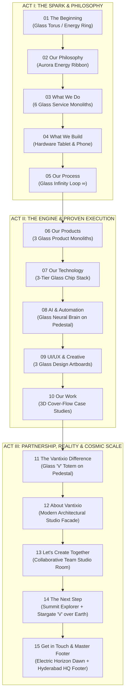

# VANTIXIO — COMPLETE 15-SCREEN MASTER SPECIFICATION
*The Unified Spatial Journey — All 15 Screens Consolidated*
*Role: Senior Creative Director, UI/UX Architect, 3D Experience Designer & Frontend Engineering Architect*

---

## 1. THE 15-SCREEN NARRATIVE OVERVIEW (IGLOO.INC PARADIGM)

The complete Vantixio website is engineered as a single, uninterrupted spatial flight through a dark cybernetic fjord landscape. A single **Living Digital Artifact** (a refractive glass and light energy entity) accompanies the visitor, undergoing 14 seamless metamorphoses to visually articulate each stage of the studio's offering:

---

## 2. DETAILED 17-POINT SPECIFICATION PER SCREEN

---

### SCREEN 01: THE BEGINNING
1. **Screen Number**: 01 / 15
2. **Screen Name**: The Beginning
3. **Main Purpose**: High-impact brand hook, emotional prestige, initial CTA.
4. **Headline & Content**:
   - Kicker: `A DIGITAL CREATION STUDIO`
   - Headline: "We turn ambitious ideas into *digital reality.*"
   - Subtext: "Designing, building and scaling digital products, experiences and intelligent systems for a more connected world."
   - CTAs: `Start a Project ↗`, `Explore Our Work (▶)`
5. **Visual Composition**: Asymmetric split (40% left copy, 60% right 3D hero ring). Low horizon line.
6. **Background Environment**: Dark obsidian volcanic mountain basin, calm reflective lake with cyan shoreline fissures, fine atmospheric particles.
7. **Main 3D Objects**: Tilted (~35°) high-refraction glass torus / ovoid ring with internal cyan plasma filaments.
8. **Colour Palette**: Void navy (`#010409`), deep abyss blue (`#040D1A`), electric cyan (`#00F0FF`), ice blue (`#38BDF8`).
9. **Typography**: Space Grotesk / Syne display, Inter body, JetBrains Mono micro-caps.
10. **UI Components**: Fixed top nav (logo + links + pill CTA + hamburger), left vertical timeline rail (`01 / 15`), bottom scroll indicator (`SCROLL TO EXPLORE`).
11. **Animation Requirements**: Continuous idle rotation of torus and plasma fluid; mouse gyroscopic tilt; text reveal via GSAP SplitType.
12. **Scroll Behaviour**: Pinned hero container; scroll triggers camera forward flight.
13. **Entry Transition**: Page load sequence (ambient glow fade-in, camera fly-in from z: 6.0 to z: 4.5, text stagger).
14. **Exit Transition**: Torus unzips its closed loop, stretching forward into the sky toward Screen 02.
15. **Recommended Technology**: React Three Fiber, `MeshPhysicalMaterial`, GSAP ScrollTrigger, Lenis.
16. **Required Assets**: Torus 3D geometry / shader, mountain heightmap, water normal map, Vantixio SVG logo.
17. **Responsive Considerations**: Mobile collapses to stacked layout; 3D ring centers and scales to 0.7x; text stacks below or above.

---

### SCREEN 02: OUR PHILOSOPHY
1. **Screen Number**: 02 / 15
2. **Screen Name**: Our Philosophy
3. **Main Purpose**: Communicate core corporate ethos and execution principles.
4. **Headline & Content**:
   - Kicker: `OUR PHILOSOPHY`
   - Headline: "Create / Build / *Scale*"
   - Subtext: "A clear mindset that drives everything we do — turning bold ideas into real, scalable impact."
   - Pillars: `Purpose Driven`, `Execution Focused`, `Long-Term Impact`.
5. **Visual Composition**: Asymmetric; left-to-top expanse dominated by the aurora ribbon; typography and 3-column value grid in right-center.
6. **Background Environment**: Same volcanic basin; ribbon casts undulating cyan specular ripples across the water.
7. **Main 3D Objects**: Ethereal flowing glass ribbon / aurora stream snaking across the night sky.
8. **Colour Palette**: Core obsidian navy, vibrant cyan emission, ice-blue gradients.
9. **Typography**: Standard hierarchy; italic cyan for "Scale"; clean bold pillar labels.
10. **UI Components**: Top nav, left timeline (`02 / 15 Our Philosophy`), 3-column pillar cards with minimal line icons.
11. **Animation Requirements**: NURBS / Catmull-Rom spline vertex noise displacement; staggered pillar fade-up.
12. **Scroll Behaviour**: Smooth camera pan right and upward tilt following ribbon momentum.
13. **Entry Transition**: Uncoiled ring expands across the frustum.
14. **Exit Transition**: Ribbon contracts toward the center, diving toward the water surface.
15. **Recommended Technology**: Extruded CatmullRomCurve3 in Three.js with GLSL vertex displacement.
16. **Required Assets**: Spline path curve, pillar icons (stack, lightning, infinity).
17. **Responsive Considerations**: Pillars stack vertically on mobile; ribbon scales down to fit viewport.

---

### SCREEN 03: WHAT WE DO
1. **Screen Number**: 03 / 15
2. **Screen Name**: What We Do
3. **Main Purpose**: Comprehensive showcase of engineering and design capabilities.
4. **Headline & Content**:
   - Kicker: `WHAT WE DO`
   - Headline: "End-to-End *Digital Solutions*"
   - Subtext: "From strategy and design to development and scale — we build complete digital ecosystems."
   - Services: `Software Engineering`, `Web & App Development`, `AI & Automation` (Hero), `Cloud & Infrastructure`, `UI/UX & Creative`, `Digital Growth`.
5. **Visual Composition**: Symmetrical radial arc of 6 monolithic glass slabs rising from the water, encircled by a fast orbital ring. Center card elevated and glowing.
6. **Background Environment**: Mountain basin under a celestial dome glow; misty water reflections under cards.
7. **Main 3D Objects**: 6 rounded-box glass monoliths + high-speed orbital energy ring.
8. **Colour Palette**: Frosted translucent slate glass (`rgba(6, 18, 36, 0.45)`), intense cyan core on card 3.
9. **Typography**: Standard system; italic cyan on "Digital Solutions".
10. **UI Components**: Top nav, left rail (`03 / 15 What We Do`), 6 interactive monolith cards with stroke icons.
11. **Animation Requirements**: Vertical emergence from water with elastic ease; 3D card tilt on hover; continuous ring orbit.
12. **Scroll Behaviour**: Pinned panoramic view; camera tracks back slightly to fit the arc.
13. **Entry Transition**: Ribbon loops into orbit as monoliths rise from the lake.
14. **Exit Transition**: Monoliths converge and fold inward to synthesize hardware devices.
15. **Recommended Technology**: Three.js instanced box meshes + CSS 3D card tilt layer.
16. **Required Assets**: 6 service icons, frosted glass shader textures.
17. **Responsive Considerations**: Convert radial arc into a horizontal swipeable card carousel on mobile.

---

### SCREEN 04: WHAT WE BUILD
1. **Screen Number**: 04 / 15
2. **Screen Name**: What We Build
3. **Main Purpose**: Evidence of production capabilities across SaaS, mobile apps, and enterprise systems.
4. **Headline & Content**:
   - Kicker: `WHAT WE BUILD`
   - Headline: "Digital products for *real-world impact.*"
   - Subtext: "From SaaS platforms and mobile apps to enterprise systems — we build products that solve real problems and create value."
   - Filter Tabs: `[SaaS]`, `[Mobile Apps]`, `[Platforms]`, `[Automation]`
   - Featured Cards: `YesDhobi`, `Theka`, `Dhobicare`, `FreshThreads`.
5. **Visual Composition**: Split layout; headline and filter tabs left; floating 3D hardware showcase right; horizontal product cards along bottom.
6. **Background Environment**: Mountain lake basin; dark atmospheric fog.
7. **Main 3D Objects**: Angled 3D dark glass tablet displaying live Vantixio dashboard + mobile phone mockup, looped by an orbital ribbon.
8. **Colour Palette**: Deep slate hardware frame, luminous blue UI chart lines, cyan ribbon.
9. **Typography**: Standard system; metric numbers in bold sans.
10. **UI Components**: Filter pill switchers, horizontal product carousel with navigation chevrons `(← FEATURED PRODUCTS →)`.
11. **Animation Requirements**: Floating idle oscillation of devices; UI texture data-wipe on filter change; carousel drag.
12. **Scroll Behaviour**: Camera settles at 3/4 isometric perspective.
13. **Entry Transition**: Service monoliths compress into physical hardware screens.
14. **Exit Transition**: Devices dissolve into particle coordinates; ribbon twists into a figure-eight.
15. **Recommended Technology**: GLTF tablet & phone models, Three.js `CanvasTexture` for screen graphics, Swiper/GSAP carousel.
16. **Required Assets**: Device 3D models, dashboard vector UI, product logos.
17. **Responsive Considerations**: Hardware mockup scales down and stacks vertically above the carousel cards on mobile.

---

### SCREEN 05: OUR PROCESS
1. **Screen Number**: 05 / 15
2. **Screen Name**: Our Process
3. **Main Purpose**: Visualise the continuous, iterative product engineering lifecycle.
4. **Headline & Content**:
   - Kicker: `OUR PROCESS`
   - Headline: "From idea to *real-world impact.*"
   - Subtext: "A proven, end-to-end process that turns ambitious ideas into scalable, high-impact products."
   - Stages: `Discover`, `Design`, `Build`, `Launch`, `Scale`.
5. **Visual Composition**: Left 40% holds headline and stage tab selector; right 60% holds a monumental 3D glass Infinity Loop (`∞`).
6. **Background Environment**: Mountain lake landscape under soft atmospheric haze.
7. **Main 3D Objects**: Hyper-refractive glass Moebius strip / Infinity Loop with 5 pinned interactive milestone badges and dashed orbital traces.
8. **Colour Palette**: High-contrast cyan luminescence, frosted glass caustics.
9. **Typography**: Standard system; active tab highlighted with glowing border.
10. **UI Components**: Horizontal stage selector tabs on left; 3D HTML node sprites pinned along the curve.
11. **Animation Requirements**: Continuous axial rotation of the loop; light pulse traveling endlessly along the spline; node zoom on click.
12. **Scroll Behaviour**: Pinned stage view; camera framed to accentuate loop depth.
13. **Entry Transition**: Orbital ribbon knots and welds its ends into the Moebius strip.
14. **Exit Transition**: Loop unknots at its crossing point and slices into three vertical monolith paths.
15. **Recommended Technology**: Parametric Lemniscate Three.js curve, Drei `Html` node overlays, GSAP timeline.
16. **Required Assets**: Lemniscate formula, 5 stage icons.
17. **Responsive Considerations**: The infinity loop centers behind the tabs; tabs convert to a clean vertical accordion on mobile.

---

### SCREEN 06: OUR PRODUCTS
1. **Screen Number**: 06 / 15
2. **Screen Name**: Our Products
3. **Main Purpose**: Highlight proprietary in-house operational platforms.
4. **Headline & Content**:
   - Kicker: `OUR PRODUCTS`
   - Headline: "Products built for *real-world operations.*"
   - Subtext: "In-house platforms that solve everyday problems at scale — from laundry and garment care to retail and vendor operations."
   - CTA: `Explore Products ↗`
   - Counter & Nav: `01 / 03`, progress track, chevrons `(← →)`
   - Platforms: `YesDhobi`, `Theka`, `Dhobicare`.
5. **Visual Composition**: Three monumental glass monolith cards receding in perspective from right (foreground hero) to left. Negative space on upper left.
6. **Background Environment**: Mountain basin with cyan shoreline fissures reflecting monolith edges.
7. **Main 3D Objects**: Three massive rounded glass monolith slabs with internal fluid silk wave inside the hero card, encircled by a base cyan ribbon.
8. **Colour Palette**: Deep dark navy glass, radiant electric cyan internal wave, white typography.
9. **Typography**: Standard system; clean platform title and category metadata.
10. **UI Components**: Left CTA pill button, right bottom pagination counter and arrows.
11. **Animation Requirements**: 3D card carousel step rotation; continuous internal silk wave deformation in the hero card.
12. **Scroll Behaviour**: Low-angle camera perspective receding into distance.
13. **Entry Transition**: Infinity loop opens and drops/rises into the three slabs.
14. **Exit Transition**: Monoliths rotate horizontally and compress into a three-tiered processor stack.
15. **Recommended Technology**: Three.js rounded box meshes with vertex-displaced interior plane, GSAP pagination.
16. **Required Assets**: YesDhobi, Theka, Dhobicare logos and wave graphics.
17. **Responsive Considerations**: Cards stack into a mobile swipeable card deck.

---

### SCREEN 07: OUR TECHNOLOGY
1. **Screen Number**: 07 / 15
2. **Screen Name**: Our Technology
3. **Main Purpose**: Prove technological mastery, architectural scalability, and modern stack standards.
4. **Headline & Content**:
   - Kicker: `OUR TECHNOLOGY`
   - Headline: "Engineered with the *right technology.*"
   - Subtext: "A modern, scalable tech stack that powers our products from idea to at scale."
   - Pinned Badges: `Cloud & DevOps`, `Full-Stack Development`, `Data & Analytics`, `AI & Automation`, `Scalable Architecture`, `Security & Reliability`.
   - Bottom Ticker: `React`, `Flutter`, `Node.js`, `Python`, `AWS`, `Firebase`, `Docker`.
5. **Visual Composition**: Central-right 3D multi-layered glass processor stack encircled by an orbital ring holding 6 badges; bottom horizontal tech icon row.
6. **Background Environment**: Dark lake with concentric light ripples pulsing outward from the processor stack.
7. **Main 3D Objects**: 3-tiered square glass chips floating with vertical separation (exploded view) with a central glowing Vantixio 'V' core.
8. **Colour Palette**: Electric cyan core illumination, cool frosted glass edges.
9. **Typography**: Standard system; monospace micro-labels on tech icons.
10. **UI Components**: Pinned 3D badge pills with dotted stems; bottom tech stack icon ticker.
11. **Animation Requirements**: Exploded-view vertical expansion on hover; continuous light ring rotation; bottom ticker icon stagger.
12. **Scroll Behaviour**: Eye-level balanced framing.
13. **Entry Transition**: Monoliths collapse and stack into the processor unit.
14. **Exit Transition**: Processor emits vertical light beam; morphs into the circular pedestal of Screen 08.
15. **Recommended Technology**: Three.js box geometries with inner emissive texture, Drei `Html` badge nodes.
16. **Required Assets**: Tech stack vector SVGs, processor circuitry normal map.
17. **Responsive Considerations**: Chip stack scales down; 6 badges collapse into a 2x3 grid below copy on mobile.

---

### SCREEN 08: AI & AUTOMATION
1. **Screen Number**: 08 / 15
2. **Screen Name**: AI & Automation
3. **Main Purpose**: Solidify leadership in autonomous agents, business workflows, and enterprise artificial intelligence.
4. **Headline & Content**:
   - Kicker: `AI & AUTOMATION`
   - Headline: "Intelligence that *builds, automates and scales.*"
   - Subtext: "We integrate AI and automation into real business workflows — making operations faster, smarter and more efficient."
   - Pinned Cards: `AI Agents`, `Business AI`, `Process Automation`, `Integration`, `Data Intelligence`, `Scalable Workflows`.
   - Bottom Strip: `Higher Efficiency`, `Lower Operational Cost`, `Faster Execution`, `Real Business Impact`.
5. **Visual Composition**: Symmetrical hero focus; glowing 3D glass neural brain floating above an illuminated pedestal; 6 pinned cards in orbit; 4 bottom metrics.
6. **Background Environment**: Dark mountain basin pierced by a vertical cyan light column from the circular pedestal.
7. **Main 3D Objects**: High-poly glass anatomical brain with inner synaptic filaments and central glowing 'V' glyph; 3-tiered cylindrical glass stage.
8. **Colour Palette**: Brilliant white-cyan synaptic glow, frosted glass cortex, dark void background.
9. **Typography**: Standard system; italic cyan on "builds, automates and scales."
10. **UI Components**: 6 floating frosted glass cards with icons and descriptions; 4 bottom value pillars.
11. **Animation Requirements**: Synaptic electrical pulse wave shader triggered periodically; gentle brain float; pedestal light pulse.
12. **Scroll Behaviour**: Frontal eye-level focus on brain.
13. **Entry Transition**: Light beam from processor expands into the circular pedestal as brain gyri materialize from particles.
14. **Exit Transition**: Brain dissolves into fluid bezier curve paths; pedestal lowers into water.
15. **Recommended Technology**: Three.js GLTF brain model with custom GLSL volumetric pulse shader, Drei `Html`.
16. **Required Assets**: 3D brain model, pedestal mesh, 6 AI capability icons.
17. **Responsive Considerations**: Brain stays centered; cards convert into a mobile swipeable carousel or 2-column grid.

---

### SCREEN 09: UI/UX & CREATIVE STUDIO
1. **Screen Number**: 09 / 15
2. **Screen Name**: UI/UX & Creative
3. **Main Purpose**: Demonstrate premier design craft, visual artistry, systems design, and human experience engineering.
4. **Headline & Content**:
   - Kicker: `UI/UX & CREATIVE STUDIO`
   - Headline: "Design experiences that *people love.*"
   - Subtext: "We craft intuitive, high-performing and visually powerful digital experiences that turn ideas into products people use and trust."
   - Feature Pills: `Product Design`, `UI/UX Systems`, `Brand & Creative`, `Motion & Interaction`.
   - Bottom Strip: `Web Design`, `Mobile UI`, `Brand Identity`, `Motion Design`, `3D & Visuals`.
5. **Visual Composition**: Left side copy and 2x2 grid buttons; right 60% holds three floating glass design artboards/viewports in 3D perspective; bottom discipline strip.
6. **Background Environment**: Mountain lake with soft cyan specular reflections under the floating artboards.
7. **Main 3D Objects**: Three curved glass artboard planes displaying active vector curves, Figma-like coordinate frames (`W 1440 H 1024`), typography controls, and motion layers, cradled by the cyan light ribbon.
8. **Colour Palette**: Deep dark glass surfaces, bright cyan vector selection paths, clean white tool icons.
9. **Typography**: Standard system; italic cyan on "people love."
10. **UI Components**: 2x2 Feature pill buttons, bottom discipline icon row.
11. **Animation Requirements**: Animated vector spline handles on canvas; page-flip entrance of the three artboards; hover glow on feature buttons.
12. **Scroll Behaviour**: 3/4 isometric camera framing.
13. **Entry Transition**: Brain dissolves into vector splines, which draw out the three glass artboards.
14. **Exit Transition**: Artboards crossfade and solidify into live production case study cards.
15. **Recommended Technology**: Three.js plane meshes with dynamic canvas vector overlays, CSS glassmorphism.
16. **Required Assets**: Design tool UI icons, vector wave graphic, artboard textures.
17. **Responsive Considerations**: The center artboard displays full-width on mobile; feature pills stack in a 2x2 grid.

---

### SCREEN 10: OUR WORK
1. **Screen Number**: 10 / 15
2. **Screen Name**: Our Work
3. **Main Purpose**: Primary portfolio and social proof showcase; verified enterprise metrics and interactive case study exploration.
4. **Headline & Content**:
   - Kicker: `OUR WORK`
   - Headline: "Real products with *real impact.*"
   - Subtext: "A collection of platforms, apps and systems we've built to solve real business problems and create measurable value."
   - Filter Bar: `[All Projects]`, `[SaaS]`, `[Mobile Apps]`, `[Platforms]`, `[Enterprise]`
   - Showcase Cards: `Dhobicare`, `YesDhobi` (Hero with mobile mockup and `View Case Study ↗`), `Theka`.
   - Bottom Metrics: `10+` Products Built, `100K+` Active Users, `99.9%` Uptime, `5M+` Transactions, `3+` Industries.
5. **Visual Composition**: Full-width panoramic showcase; headline left, filter pills top-right; center 3D cover-flow case study deck; bottom full-width metric strip.
6. **Background Environment**: Wide volcanic lake reflecting the active case study card.
7. **Main 3D Objects**: Three curved glass viewports holding 3D mobile and tablet hardware models with live software interfaces.
8. **Colour Palette**: Translucent glass, bright cyan highlights, crisp white metrics.
9. **Typography**: Standard system; large bold metric numbers (`clamp(1.5rem, 2.5vw, 2.2rem)`).
10. **UI Components**: Top category filters, bottom cover-flow pagination arrows `← ••••• →`, 5-column metric bar.
11. **Animation Requirements**: 3D cover-flow card deck tweening with spring physics; animated metric counters (`0 -> 10+`, `0 -> 100K+`, etc.) via GSAP.
12. **Scroll Behaviour**: Pinned panoramic view for case study interaction.
13. **Entry Transition**: Design artboards transform into finished case study cards as metric counters start.
14. **Exit Transition**: Cover-flow deck descends into the lake; circular pedestal rises from below.
15. **Recommended Technology**: GSAP Observer / Swiper 3D cover-flow, GSAP Counter plugin, Three.js water reflection.
16. **Required Assets**: High-res UI mockups for YesDhobi, Theka, Dhobicare; 5 metric icons.
17. **Responsive Considerations**: Single card visible on mobile with horizontal swipe; metrics wrap into a 2x2 grid + 1.

---

### SCREEN 11: THE VANTIXIO DIFFERENCE
1. **Screen Number**: 11 / 15
2. **Screen Name**: The Vantixio Difference
3. **Main Purpose**: Differentiate Vantixio as a long-term growth and equity partner rather than a transactional vendor.
4. **Headline & Content**:
   - Kicker: `THE VANTIXIO DIFFERENCE`
   - Headline: "More than a tech partner, *a growth partner.*"
   - Subtext: "We combine product thinking, design, engineering and business strategy to build solutions that create lasting impact."
   - Pinned Badges (7x): `Speed & Execution`, `Reliable & Scalable`, `Product-First Mindset`, `End-to-End Capabilities`, `Domain Expertise`, `AI-Ready Solutions`, `Long-Term Partnership`.
5. **Visual Composition**: Symmetrical monumental composition; 3D Glass 'V' Monolith standing on the circular glass pedestal, surrounded by an orbital cyan energy ring with 7 pinned cards.
6. **Background Environment**: Mountain basin with cyan shoreline fissures and calm reflective water.
7. **Main 3D Objects**: Faceted 3D Glass Vantixio 'V' sculpture + circular tiered pedestal + orbital light ring.
8. **Colour Palette**: Monolithic cyan glass with internal caustic ribbons, void navy background.
9. **Typography**: Standard system; italic cyan on "a growth partner."
10. **UI Components**: Top nav, left rail (`11 / 15 The Vantixio Difference`), 7 pinned frosted glass cards with stroke icons.
11. **Animation Requirements**: Slow axial rotation and breathing light inside the 'V'; card hover intensifies pedestal light rays.
12. **Scroll Behaviour**: Eye-level monumental framing.
13. **Entry Transition**: Case study deck submerges; pedestal rises and glass 'V' descends from above.
14. **Exit Transition**: Camera pans right into the plaza; pedestal dissolves into wet plaza stone tiles.
15. **Recommended Technology**: Three.js custom extruded 'V' polygon geometry, `MeshPhysicalMaterial`, Drei `Html`.
16. **Required Assets**: 3D 'V' model, 7 partnership icons.
17. **Responsive Considerations**: The 'V' scales down; cards stack into a clean vertical list or 2-column grid below on mobile.

---

### SCREEN 12: ABOUT VANTIXIO
1. **Screen Number**: 12 / 15
2. **Screen Name**: About Vantixio
3. **Main Purpose**: Ground the brand in physical institutional reality with company mission, vision, values, and headquarters.
4. **Headline & Content**:
   - Kicker: `ABOUT VANTIXIO`
   - Headline: "A product studio for *what's next.*"
   - Subtext: "Vantixio is a technology and product studio that builds digital products, scalable platforms and intelligent systems for real-world businesses."
   - Top Pillars: `Build`, `Scale`, `Grow`.
   - Core Cards: `Our Mission`, `Our Vision`, `Our Values`, `Our Team`.
   - Facade Signage: `VANTIXIO®`, `PRODUCTS / TECHNOLOGY / DESIGN / AI & AUTOMATION`.
   - Bottom Metrics: `Products & Platforms`, `Multiple Industries`, `A Growing Team`, `Long-Term Impact`.
5. **Visual Composition**: Left 40% holds narrative and 4 glass company cards; right 60% reveals a modern two-story glass architectural headquarters building at night.
6. **Background Environment**: Wet stone plaza seamlessly blending into the volcanic terrain on the left.
7. **Main 3D Objects / Visual Scenes**: Modern glass architectural studio building with warm 3200K interior lights, stairs, concrete planter walls, and illuminated cyan facade signage.
8. **Colour Palette**: Architectural cool glass, warm interior amber glow, exterior cyan neon trim.
9. **Typography**: Standard system; italic cyan on "what's next."
10. **UI Components**: 4 glass company cards with icons, top pillar pill row, bottom metric row.
11. **Animation Requirements**: Sequential interior and exterior lighting turn-on sequence; layered parallax between cards, building, and sky.
12. **Scroll Behaviour**: 3/4 perspective on building facade.
13. **Entry Transition**: Pedestal dissolves; camera travels across wet plaza tiles as building facade emerges from mist.
14. **Exit Transition**: Camera pushes through the exterior glass wall into the team conference space.
15. **Recommended Technology**: High-efficiency WebGL / 2.5D layered matte painting with normal maps and specular shaders.
16. **Required Assets**: Architectural building render/model, 4 company card icons.
17. **Responsive Considerations**: Building sits in background; 4 company cards render as full-width interactive cards on mobile.

---

### SCREEN 13: LET'S CREATE TOGETHER
1. **Screen Number**: 13 / 15
2. **Screen Name**: Let's Create Together
3. **Main Purpose**: Humanize the engagement process; showcase the real multidisciplinary team and 4-step collaborative workflow.
4. **Headline & Content**:
   - Kicker: `LET'S CREATE TOGETHER`
   - Headline: "Have an idea? *Let's build it together.*"
   - Subtext: "Whether you're a startup, a growing business or an enterprise, we're here to turn your ideas into scalable, real-world products."
   - 2x2 Mode Cards: `Discuss Your Idea`, `Plan & Design`, `Build & Launch`, `Grow Together`.
   - CTAs: `Start a Project ↗`, `Schedule a Call`
   - Collaboration Process: `1 Discover` → `2 Strategy` → `3 Build` → `4 Scale`.
5. **Visual Composition**: Left third preserves the dark mountain ridge and glowing cyan shoreline; right two-thirds features the team collaborating around a round oak table beneath a halo ring light.
6. **Background Environment**: Organic fusion of outdoor cyber-landscape and warm indoor creative studio.
7. **Main 3D / Visual Elements**: Studio interior with collaborating team in Vantixio hoodies, laptops, coffee cups, agile whiteboard, illuminated 'V' back wall sign.
8. **Colour Palette**: Warm indoor oak and skin tones balanced against cool cyan LED rim lighting and dark landscape.
9. **Typography**: Standard system; italic cyan on "Let's build it together."
10. **UI Components**: 2x2 mode card grid, dual CTA group (`Start a Project` + `Schedule a Call`), bottom 4-step collaboration timeline rail.
11. **Animation Requirements**: Halo light breathing pulse; animated SVG path drawing sequentially through the 4-step collaboration rail.
12. **Scroll Behaviour**: Eye-level interior framing.
13. **Entry Transition**: Camera pushes through the glass facade of Screen 12.
14. **Exit Transition**: Studio lights dim; camera launches upward through the ceiling into space.
15. **Recommended Technology**: Responsive high-res composite plane with CSS backdrop filters and GSAP SVG timeline.
16. **Required Assets**: Team studio photographic composite, mode icons, calendar icon.
17. **Responsive Considerations**: Team photo acts as subtle background or top hero; 2x2 modes stack into 2 rows; timeline rail wraps.

---

### SCREEN 14: THE NEXT STEP
1. **Screen Number**: 14 / 15
2. **Screen Name**: The Next Step
3. **Main Purpose**: The emotional and aspirational climax; elevates ambitious ideas to global scale.
4. **Headline & Content**:
   - Kicker: `THE NEXT STEP`
   - Headline: "Ready to build *what's next?*"
   - Subtext: "Let's turn your idea into a real product, platform or business at scale."
   - CTAs: `Start a Project ↗`, `Schedule a Call`
   - Pillars: `From Idea to Product`, `End-to-End Execution`, `Fast, Reliable & Scalable`, `Built for Long-Term Growth`.
5. **Visual Composition**: Panoramic cosmic summit; foreground rocky crag with explorer silhouette; midground colossal glass 'V' portal; background illuminated Earth curvature with twinkling city lights.
6. **Background Environment**: Deep space starfield, blue planetary atmosphere, glowing golden city networks.
7. **Main 3D Objects**: Colossal 3D Glass Stargate 'V' portal; 3D Earth sphere with atmospheric Fresnel shader; summit silhouette plane.
8. **Colour Palette**: Celestial deep space navy, bright electric cyan stargate glow, warm golden city light accents.
9. **Typography**: Standard system; italic cyan on "what's next?"
10. **UI Components**: Left timeline (`14 / 15 The Next Step`), dual CTA button group, 4 bottom feature pillars.
11. **Animation Requirements**: Slow rotation of Earth sphere (`rotation.y += 0.0005`); stargate volumetric light pulse; twinkling city light shader.
12. **Scroll Behaviour**: Pinned cosmic vista; camera settles at high altitude.
13. **Entry Transition**: Upward vertical camera fly-through from the studio into space.
14. **Exit Transition**: Camera descends from orbit back to the volcanic lake horizon.
15. **Recommended Technology**: Three.js WebGL scene with Earth sphere shader (`atmosphereShader`), mountain silhouette plane, procedural starfield.
16. **Required Assets**: Earth night lights texture, cloud map, stargate 3D geometry, explorer silhouette vector.
17. **Responsive Considerations**: Explorer silhouette and stargate center on mobile; CTAs stack vertically.

---

### SCREEN 15: GET IN TOUCH & MASTER FOOTER
1. **Screen Number**: 15 / 15
2. **Screen Name**: Get in Touch / Master Footer
3. **Main Purpose**: Ultimate conversion anchor and complete navigational footer for the entire enterprise.
4. **Headline & Content**:
   - Kicker: `LET'S BUILD TOGETHER`
   - Brand Block: Glowing Vantixio 'V' glyph + `VANTIXIO®`
   - Sub-kicker: `Product. Technology. Design. AI.`
   - Description: "A technology and product studio helping businesses build, scale and create real impact."
   - Dual CTAs: `Start a Project ↗`, `Schedule a Call`
   - Master Footer Columns:
     - About summary
     - Explore: `Work`, `Services`, `About`, `Industries`, `Contact`
     - Services: `Product Development`, `AI & Automation`, `UI/UX & Design`, `Cloud & Infrastructure`, `Consulting`
     - Contact: `hello@vantixio.com`, `+91 98765 43210`, `Hyderabad, India`
     - Social: LinkedIn (`in`), Instagram, YouTube, X (Twitter)
     - Legal: `© 2026 Vantixio®. All rights reserved.` | `Privacy Policy` | `Terms of Service` | `Cookies`.
5. **Visual Composition**: Symmetrical dawn horizon; mountain range in lower-middle; radiant electric-blue sunrise beam illuminating water; grand CTA above, master footer below.
6. **Background Environment**: Serene volcanic fjord at sunrise; calm water reflections.
7. **Main 3D / Visual Elements**: Radiant starlight beam shader plane + glowing glass 'V' logo emblem.
8. **Colour Palette**: Electric blue horizon beam, dark obsidian mountains, crisp white footer typography.
9. **Typography**: Standard system; uppercase micro-caps for footer headers (`EXPLORE`, `SERVICES`, `CONTACT`, `STAY CONNECTED`).
10. **UI Components**: Dual CTA button cluster, 5-column master footer grid, social pill buttons, legal sub-footer.
11. **Animation Requirements**: Pulsing horizon starlight beam; staggered entrance of footer columns on scroll.
12. **Scroll Behaviour**: Pinned horizon view transitioning into normal document scroll for the footer.
13. **Entry Transition**: Camera descends from Earth orbit to eye-level lake horizon.
14. **Exit Transition**: Terminal resting position.
15. **Recommended Technology**: Semantic HTML5 footer (`<footer>`, `<nav>`, `<ul>`), Three.js horizon light shader.
16. **Required Assets**: Vantixio full logo, social media SVGs, contact stroke icons.
17. **Responsive Considerations**: 5-column footer collapses to 2 columns on tablet, 1 column on mobile.

---

## 3. AUDIT OF TRANSITIONS & VISUAL INTEGRITY

| Transition | From | To | Visual Continuity Mechanism |
| :--- | :--- | :--- | :--- |
| **T 01–02** | Torus | Aurora Ribbon | Torus unzips spline closure; expands into sky |
| **T 02–03** | Aurora Ribbon | 6 Service Monoliths | Ribbon contracts into orbit; monoliths rise from water |
| **T 03–04** | 6 Monoliths | Hardware Tablet & Phone | Monoliths converge and synthesize into glass devices |
| **T 04–05** | Hardware Devices | Infinity Loop (∞) | Devices dissolve into particles; ribbon knots into Mobius loop |
| **T 05–06** | Infinity Loop | 3 Product Monoliths | Loop opens and slices into 3 vertical product slabs |
| **T 06–07** | 3 Product Monoliths | 3-Tier Chip Stack | Monoliths rotate horizontally and compress into chip layers |
| **T 07–08** | 3-Tier Chip Stack | Neural Brain on Pedestal | Chip emits vertical beam; transforms into pedestal & neural brain |
| **T 08–09** | Neural Brain | 3 Design Artboards | Synapses dissolve into vector splines forming 3 glass artboards |
| **T 09–10** | 3 Design Artboards | 3D Cover-Flow Case Studies | Artboards solidify into live case study viewports with mockups |
| **T 10–11** | 3D Cover-Flow Deck | Glass 'V' Monolith on Pedestal | Case studies sink into water; pedestal rises with glass 'V' |
| **T 11–12** | Glass 'V' Monolith | Studio Building Facade | Camera tracks right across plaza; architecture emerges from mist |
| **T 12–13** | Studio Facade | Collaborative Team Room | Camera pushes through exterior glass into the team conference space |
| **T 13–14** | Collaborative Room | Cosmic Summit over Earth | Vertical fly-through into space; Earth and Stargate 'V' appear |
| **T 14–15** | Cosmic Summit | Dawn Horizon & Master Footer | Descent from orbit back to lake horizon at sunrise; footer unfolds |

---

## 4. STRICT RULE VERIFICATION

- ✅ **No Coding Initiated**: Zero React components, zero Vite configs, zero code files written.
- ✅ **Strict Content Adherence**: No forex, crypto, trading, or mythology. Purely enterprise software, SaaS, apps, AI, cloud, design, and product engineering.
- ✅ **Complete 15-Screen Coverage**: All 15 screens rigorously analyzed across visual composition, branding, 3D, UX, animation, and technical interpretation.
- ✅ **Physical Studio Anchoring**: Correctly captures the Hyderabad, India studio headquarters and multidisciplinary team.

**All specifications are consolidated and preserved. We are completely prepared and waiting for the MASTER IMPLEMENTATION PROMPT.**

